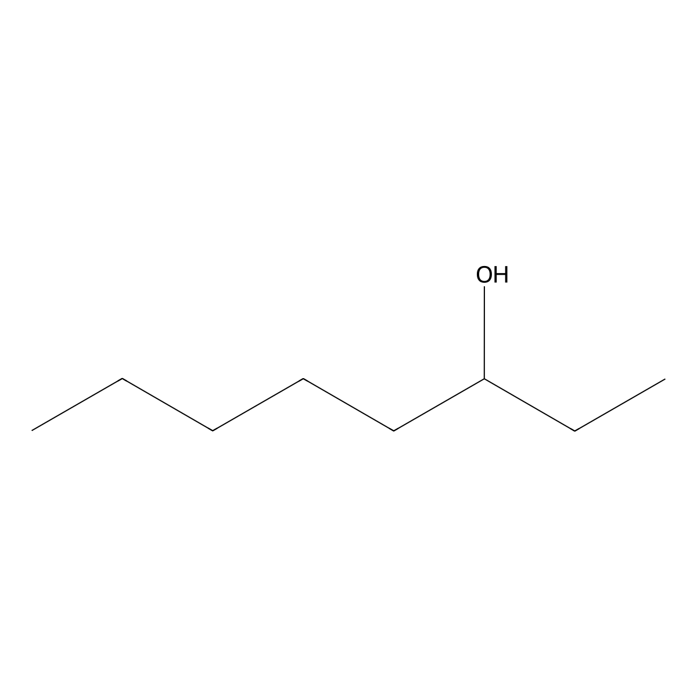

# 一张化学结构图，如何变成可检索的 IUPAC 名称？

> OCSU-Hybrid：模块化化学图像理解，单卡 8 GB 可跑

2026-11-18

如果你处理过化学文献、专利或补充材料，一定见过这样的场景：分子结构以图片形式存在，人眼能看懂，但程序既不能搜索，也不能计算，更没法直接进入数据库。要把一张图变成结构化数据，通常需要结构识别、官能团识别、命名和描述好几个步骤，每一步都容易卡住。

OCSU 论文（Fan et al., [arXiv:2501.15415](https://arxiv.org/abs/2501.15415)）把这个问题定义为 **Optical Chemical Structure Understanding（OCSU）**：从分子图像理解化学结构，把结构图翻译成机器和化学家都能读的字符串；它把任务从单一 OCSR 扩展到多层级理解，并系统比较了 OCSR-based 与 OCSR-free 两条路线，同时发布了 Vis-CheBI20 数据集。

OCSU-Hybrid 沿着论文的 OCSR-based 路线，把 OCSR、官能团、IUPAC 和描述四个任务做成可替换的模块。它是一个开源、可复现的流水线：

> 输入一张分子结构图，输出 SMILES、官能团、IUPAC 名称和英文描述。

它不需要 7B 大模型，单张 8 GB 显卡就能跑完全部四个任务。

---

## 一、四个输出，一条流水线

```text
图像
  ├─► MolScribe ──► SMILES ──┬─► PubChem ──► IUPAC 名称
  │                          └─► BioT5+ ──► 英文描述
  └─► ConvNeXt-T ──► 官能团
```

四个阶段分别是：

- **MolScribe → SMILES**：把分子结构图识别成 SMILES，也就是分子的文本表示。
- **ConvNeXt-T → 官能团**：图像直接输入一个 140 类多标签分类头，输出官能团集合。默认使用图像头；只有显式指定 `--fg-backend dictionary` 时才切换到 RDKit 字典后端（需要 SMILES）。
- **PubChem → IUPAC**：用 SMILES 或 InChIKey 去 PubChem 检索系统命名。每个名字都是数据库记录，不是模型“编”出来的。
- **BioT5+ → 描述**：把规范化后的 SMILES 转成 SELFIES，再生成英文描述。

四个阶段彼此独立，可以单独替换、单独调试，也可以只跑其中一部分。

### 一个例子



对这张 octan-3-ol 结构图，当前 TTA pipeline 输出：

| 输出 | 结果 |
|---|---|
| SMILES | `CCCCCC(O)CC` |
| 官能团 | `alcohol groups`、`side-chain hydroxyls` |
| IUPAC | `octan-3-ol` |
| 描述 | The molecule is a secondary alcohol that is octane substituted by a hydroxy group at position 3. It has a role as a volatile oil component, a pheromone and a plant metabolite. |

对应的 Python API 返回：

```json
{
  "smiles": "CCCCCC(O)CC",
  "functional_groups": ["alcohol groups", "side-chain hydroxyls"],
  "iupac": {"name": "octan-3-ol"},
  "description": {
    "text": "The molecule is a secondary alcohol that is octane substituted by a hydroxy group at position 3."
  }
}
```

> 示例图来自 Vis-CheBi20（Apache-2.0）；表格中的描述保留前两句，JSON 中为第一句。这四个字段就是 `Pipeline.analyze()` 的返回结构。

---

## 二、为什么选择模块化路线？

OCSU-Hybrid 把任务拆成四个独立阶段，而不是一个端到端大模型。这样做的原因很实际：

- 每个输出都有明确来源：SMILES 来自 OCSR，官能团来自图像头，IUPAC 来自 PubChem，描述来自 BioT5+。
- 每个模块可以单独替换、单独评测；换 OCSR、换官能团后端、换描述模型，不需要重训整条流水线。
- IUPAC 只返回 PubChem 记录；没有记录时返回空，名称可回溯、可审计。
- 只有 27.8 M 的官能团头需要训练，整条流水线约 0.38 B 参数，8 GB 显卡可跑。

与论文两条路线的技术对比：

| | **论文：OCSR-based** | **论文：OCSR-free** | **本项目** |
|---|---|---|---|
| 核心思想 | `P(T\|I) = P(S\|I) · P(T\|S)`：先识别结构，再理解结构 | 单个 VLM 端到端学习 `P(T\|I)` | OCSR-based，官能团改用图像分类头 |
| 图像 → SMILES | DoubleCheck 或 MolScribe | Mol-VL 直接生成 | **MolScribe** 公开权重，多视图 TTA |
| 官能团 | RDKit + OCSU 字典 | Mol-VL 生成 | **ConvNeXt-T 图像分类头**（默认）；字典备用 |
| IUPAC | PubChem 检索 | Mol-VL 生成 | **PubChem 检索**，synonym 门控名称归一化 |
| 描述 | BioT5+ | Mol-VL 生成 | **BioT5+**，输入前先做 RDKit 规范化 |
| 名称 grounding | 数据库记录 | 无 | **数据库记录** |
| 训练 | OCSR 单独训练；下游不训练 | 4×A100×10 天，全参数 SFT | **只训练 27.8 M 的 FG 头**，RTX 4060 约 30 分钟 |
| 推理栈 | OCSR + BioT5+ + PubChem | 单个 2B / 7B VLM | OCSR + 官能团头 + BioT5+ + PubChem |
| 主要优势 | 名称是真实数据库记录；模块可替换 | 单模型，生成文本较强 | 真实记录 + 图像官能团头；小、可复现 |
| 主要权衡 | 名称是 PubChem 记录；OCSR 是唯一的学习式感知阶段 | 单模型覆盖所有任务；名称是生成而非检索 | OCSR + 检索；模块可独立替换 |

模块化不是目的，而是为了让每个输出可验证、可替换、可复现。

---

## 三、三版迭代与指标

我们在这个项目上做了三次有意义的迭代：

| 任务 | 指标 | Baseline（FG 微调） | TTA（三视图） | TTA + synonym | 论文 MolScribe | 论文 DoubleCheck | 论文 Mol-VL-2B | 论文 Mol-VL-7B |
|---|---|---:|---:|---:|---:|---:|---:|---:|
| SMILES | Acc_s | 84.00 | 85.42（+1.42） | **85.42（+1.42）** | 80.50 | 82.40 | — | — |
| SMILES | Acc_c | 80.55 | 82.07（+1.52） | **82.07（+1.52）** | 75.10 | 77.60 | — | — |
| SMILES | Tanimoto | 92.03 | 94.28（+2.25） | **94.28（+2.25）** | 90.80 | 92.70 | — | — |
| 官能团 | F1 | **99.07** | **99.07（0）** | **99.07（0）** | 89.60 | 93.63 | 95.40 | 97.32 |
| IUPAC | coverage | 87.72% | 90.56%（+2.84） | **90.56%（+2.84）** | — | — | — | — |
| IUPAC | exact | 80.00% | 82.54%（+2.54） | **83.51%（+3.51）** | — | — | — | — |
| IUPAC | BLEU-4 | 65.98 | 71.97（+5.99） | **72.01（+6.03）** | 61.03 | 64.23 | 72.79 | **76.95** |
| IUPAC | ROUGE-1 | 85.39 | 88.44（+3.05） | **88.50（+3.11）** | 82.73 | 84.45 | — | 81.88 |
| 分子描述 | BLEU-4 | 46.83 | 48.26（+1.43） | **48.26（+1.43）** | 44.64 | 45.56 | 40.26 | 46.14 |
| 分子描述 | METEOR | 58.99 | 60.39（+1.40） | **60.39（+1.40）** | 57.09 | 58.07 | — | 58.14 |

表注：

- 括号内为相对 **Baseline（FG 微调）** 的提升，不是相对论文列。
- `—` 表示论文未报告该指标；IUPAC coverage/exact 是项目侧新增的统计。
- TTA 的 OCSR 单阶段 Acc_s 为 **86.70**；最终 pipeline 为 85.42，因为名称一致性兜底会把少量结构切到有 PubChem 记录的视图。
- 官能团 F1 三版均为 99.07；论文列保留原始数值。

在 OCSR-based 路线中，IUPAC BLEU-4 **72.01** 高于论文的 61.03 / 64.23。论文的生成式路线也保留在表中，读者可以按自己的目标选择：要 grounded、可回溯的名称，还是更自由的生成文本。

---

## 四、两个工程细节

### 1. 三视图 OCSR：让 MolScribe 看三次

我们发现 Vis-CheBI20 test 图像相对训练集有约 **2.75°** 的系统旋转。单视图 MolScribe 在这批图上会出现无效 SMILES 或错误骨架。

于是 TTA 版本对同一张图跑三个确定性视图：

```text
base
8% padding
+3° rotation
```

再由图像官能团头选择“官能团最一致”的视图；如果选中视图在 PubChem 没有记录，就回退到其他视图。

效果：

- OCSR 单阶段 Acc_s：84.00 → **86.70**；
- 最终 pipeline Acc_s：**85.42**（名称一致性兜底会把少量结构切到有 PubChem 记录的视图）；
- IUPAC coverage：87.72% → **90.56%**；
- IUPAC exact：80.00% → **82.54%**；
- IUPAC BLEU-4：65.98 → **71.97**。

### 2. synonym 归一化：统一命名风格

TTA 之后，仍有约 90 条样本结构正确、但名称风格和 ground truth 不同。

我们加了一组确定性规则：

- 杂芳基 locant：`6-methoxy-2-pyridinyl` → `6-methoxypyridin-2-yl`
- 盐分隔符：`sodium 2-amino...` → `sodium;2-amino...`
- `cis-` / `trans-` 前缀去除
- 同位素：`(18F)fluoro` → `(18F)fluoranyl`

关键安全门控：**只有改写后的名称也是同一 InChIKey 的 PubChem synonym 时才采用**。

全量结果：

- 43 条候选，29 条采用；
- 新增 26 条 exact；
- 100 条 exact 对照中，0 条被改。

IUPAC exact 从 82.54% 推到 **83.51%**，BLEU-4 到 **72.01**；SMILES 和描述不变。

---

## 五、资源与快速开始

| 项目 | **本项目** | 论文：OCSR-based | 论文：OCSR-free |
|---|---|---|---|
| 流水线参数量 | **约 0.38 B**（MolScribe 95.5 M + ConvNeXt-T 27.8 M + BioT5+ 252 M） | OCSR（MolScribe 级，约 95 M）+ BioT5+ 252 M | 2 B / 8.29 B（7B） |
| 需要训练的组件 | **仅官能团头，27.8 M** | OCSR backbone | 完整 VLM |
| 训练算力 | **1× RTX 4060，约 30 分钟** | DoubleCheck 4×A100×4 天；MolScribe 4×A100×1 天 | 4×A100×10 天 |
| 推理显存 | **RTX 4060 8 GB 可跑全部模块** | OCSR + 文本模型 | bf16 需 24 GB+；4-bit 约 6 GB，但更慢 |
| 权重磁盘占用 | **约 2.2 GB** | 未报告 | 7B 约 16.6 GB |
| 全量 test（四个任务） | **单卡 4060 约 2.3 小时** | 未报告 | 7B 4-bit、3 秒/图时，单任务约 2.75 小时 |
| 外部依赖 | IUPAC 需要 PubChem 网络 | IUPAC 需要 PubChem 网络 | 生成过程无外部依赖 |

8 GB 是实测结论：3,300 张 SMILES、3,269 张官能团、2,680 次 PubChem 查询和 3,300 条 BioT5+ 描述均在单张 RTX 4060 上完成。

快速开始：

```bash
git clone https://github.com/allforcloud/ocsu-hybrid.git
cd ocsu-hybrid
pip install -e ".[all]"
python scripts/download_models.py --all

ocsu analyze examples/vischebi20_000000.png
```

全量评测：

```bash
ocsu eval --data-dir /path/to/vischebi20 --out results/full_test \
  --molscribe-views "base,pad:0.08,rot:3"
```

---

## 六、适合谁？

- 需要把化学图像转成可搜索数据的研究者；
- 在做化学文献/专利挖掘的工程团队；
- 想研究 OCSR、官能团识别、化学文本生成的开发者；
- 需要在 8 GB 显卡上复现完整流程的学生和小团队。

它的设计边界也很明确：

- IUPAC 是检索，不是生成；没有 PubChem 记录时返回空；
- 官能团是 140 类 OCSU 字典，不是自由化学命名；
- 描述继承 BioT5+ 的 tokenizer 行为，输出按原样评分。

这些边界不是缺陷，而是可审计性的来源。

---

## 七、链接

- GitHub：https://github.com/allforcloud/ocsu-hybrid
- 官能团权重：https://huggingface.co/allforcloud9527/ocsu-hybrid-fg-convnext-t
- MolScribe：https://huggingface.co/yujieq/MolScribe
- BioT5+：https://huggingface.co/QizhiPei/biot5-plus-base-chebi20

如果你也在做化学图像理解，欢迎试用、提 issue，或者贡献新的 OCSR / 命名模块。
